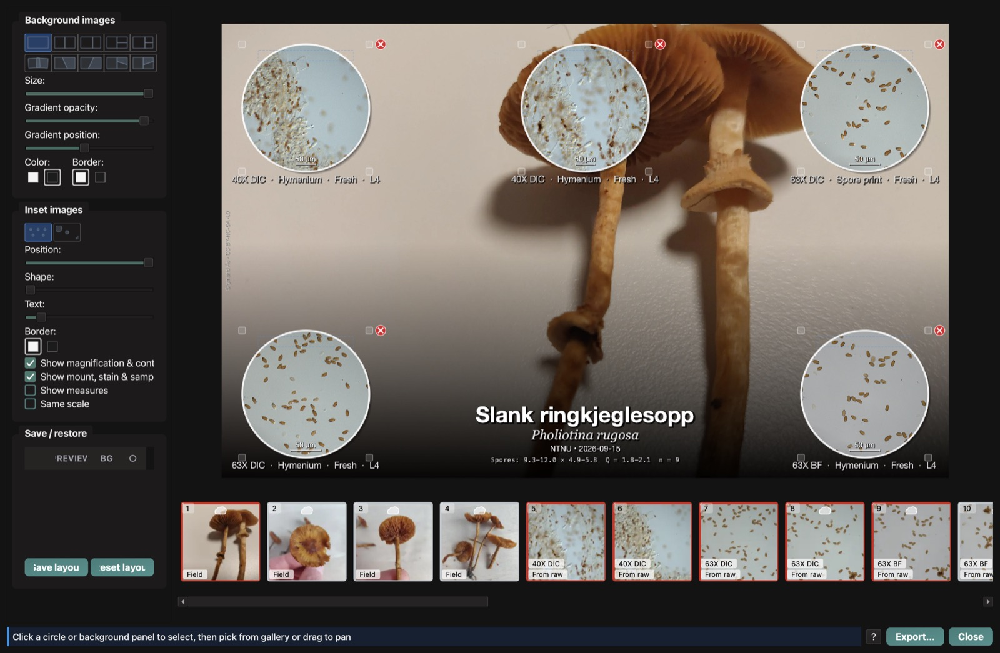
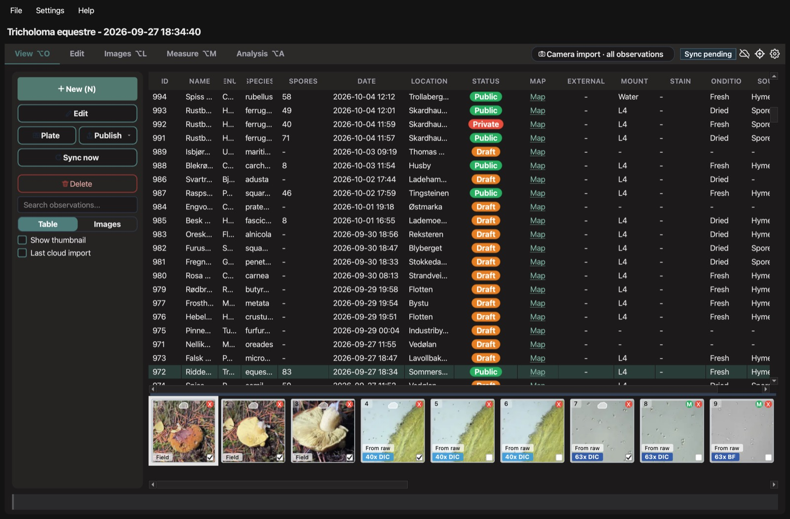
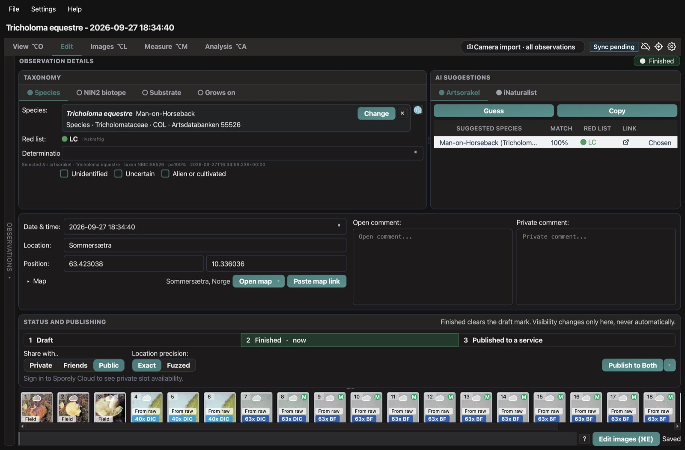
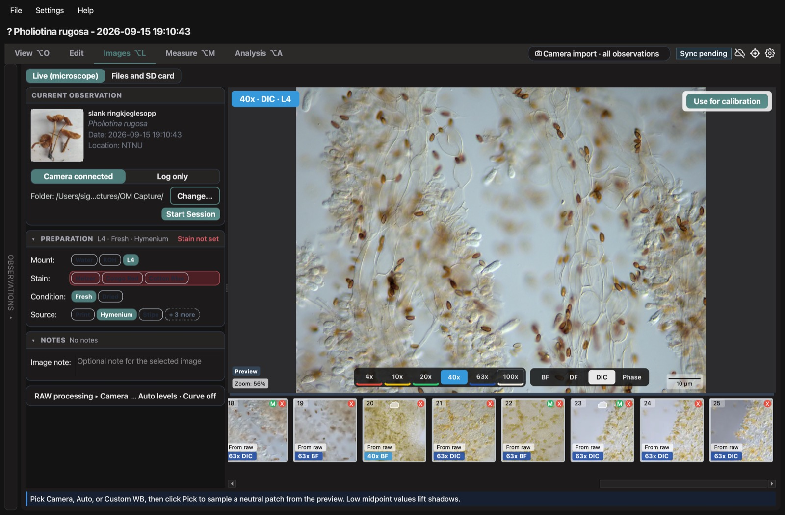
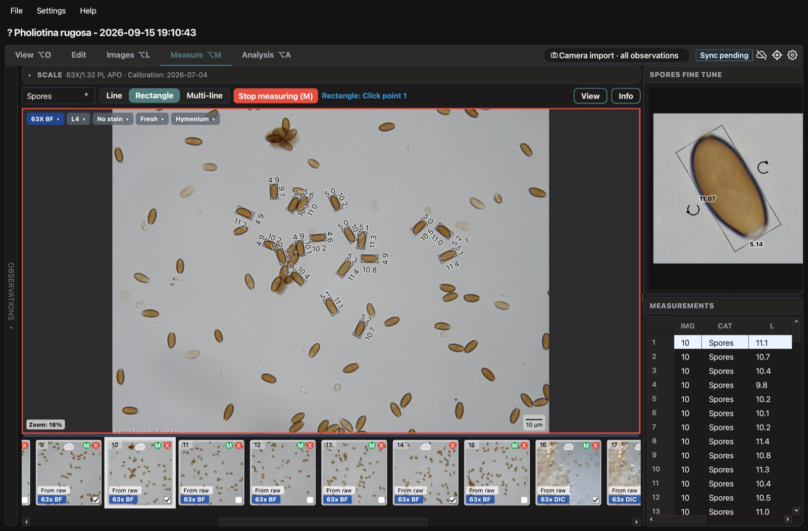
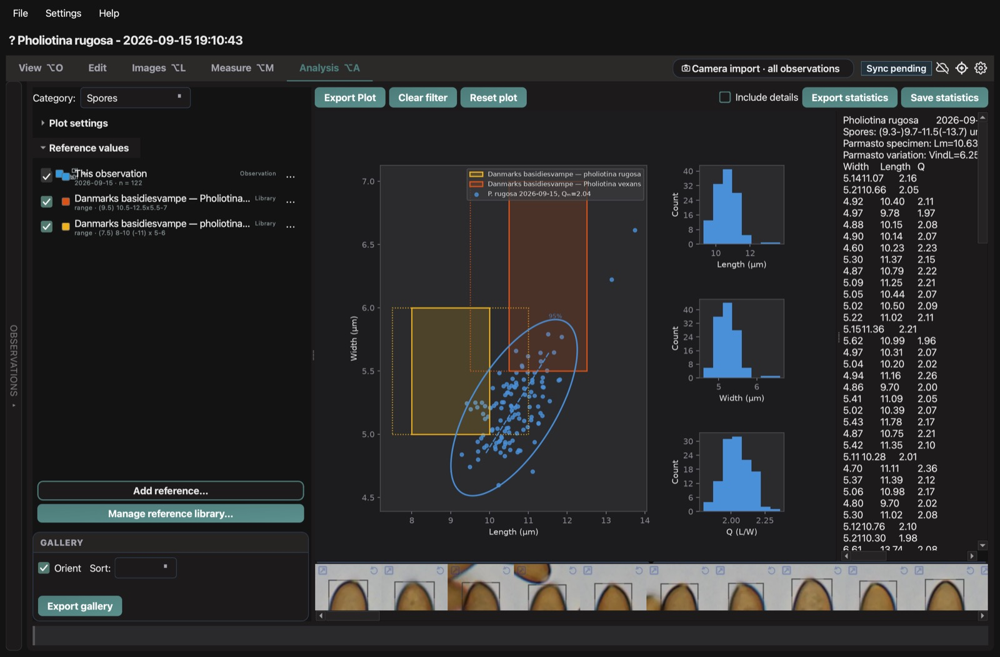
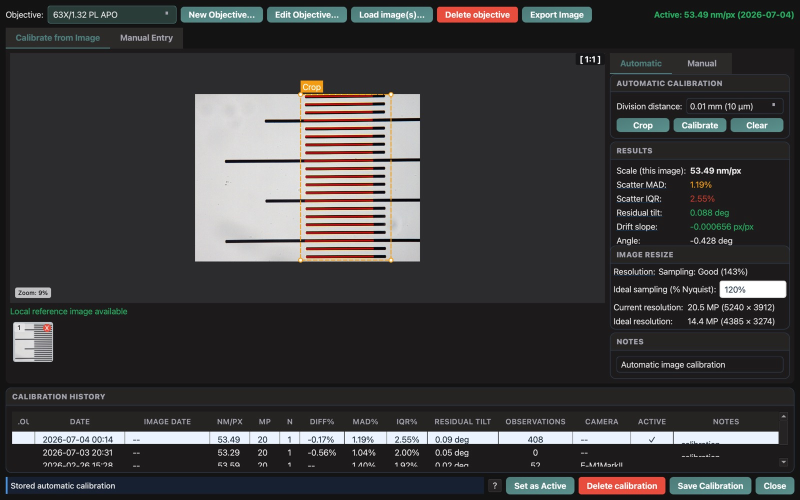

Sporely is a desktop app for mushroom field observations, microscope calibration and spore measurements.



## What Sporely is for

Sporely keeps a mushroom find together in one place: field photos, macro photos, microscope images, measurements and notes. You can follow a find from the first phone photo in the field to the microscope and the spore statistics, across devices and cameras, without losing track of it.

Sporely Cloud is built around a simple idea: spore data and analysis should be open and available to everyone. Its main purpose is to preserve, compare and share measurements, images and analysis. A second goal is social: sharing finds, places and images with friends when you choose to. The desktop app syncs with the Sporely web and Android apps.

Sporely has a Free and a Pro plan for the cloud service. Pro adds more private sync capacity and higher-quality cloud images. Prices and plan details are on [sporely.no](https://sporely.no).

Publishing and place names follow the services that make most sense locally:

- **Norway:** Norwegian place names and reporting to Artsobservasjoner.
- **Sweden:** Swedish reporting to Artportalen.
- **Denmark:** pending, with Danmarks Svampeatlas as the intended destination.
- **Everywhere else:** iNaturalist and Sporely Cloud.

## A tour of the app

The screenshots below are from the author's own observations from the 2026 season.

The window has one mode bar: **View**, **Edit**, **Images**, **Measure** and **Analysis**, with **Camera import** on the right. In Images, Measure and Analysis the observation list folds into a thin rail on the left; click it to open the list as a drawer and switch observations without leaving the page.

### View

Every find is a row in **View**, as a table or with large image previews, and its field and microscope images run along the strip below. From here you create, publish and sync observations and open the species plate.



### Edit

**Edit** opens the selected observation in the main window, and changes save as you go. It holds the species, date, coordinates, place name and comments. Search for a scientific or common name in one field, or ask Artsorakel or iNaturalist to suggest the species from your photos. Host (Grows on) has its own tab, and so do habitat and substrate where the region's reporting service uses them (NiN2 biotope in Norway). **Status and publishing** shows whether the observation is a draft, finished or published, publishes it to the reporting services you use, and sets who can see it in Sporely Cloud and how precisely its location is shown.



### Images

**Images** adds pictures to the current observation from two sources:

- **Live (microscope)** watches your microscope camera's capture folder during a session and brings new captures in as you work, tagged with the objective, contrast, mount, stain, condition and sample source you have selected. JPEG captures are added directly. RAW captures wait in the strip with an orange border until you choose **Save to observation** or end the session. **Log only** records a session without a connected camera.
- **Files and SD card** adds field and microscope photos from disk, or new photos from a memory card, with crop, rotate and (for field photos) AI crop.



### Measure

In **Measure** you measure spores and other structures on calibrated microscope images, with rectangles, lines or multi-line paths. Rectangles and lines can be fine-tuned in the preview on the right. Objective, contrast, mount, stain, condition and sample source are kept for every microscope image.



### Analysis

**Analysis** plots length, width and Q (L/W) for the observation, with histograms and a data ellipse, and compares them with reference values from the literature or your own reference library. Plots, statistics and an image gallery can be exported.



### Species plate

**Plate** in View builds a presentation plate from one observation: field photos in the background, microscope images as insets with their magnification and preparation, and the spore statistics as a caption. The plate at the top of this page was made this way. Layouts can be saved and reused.

### Camera import

**Camera import** works across all observations. It scans a folder and matches each photo by its timestamp, to an observation's time or to a Live Lab session. If a camera clock is off, photograph the time code Sporely shows and choose that photo to correct it.

### Calibration

Calibrate each objective from a photo of a stage micrometer, automatically or by hand, or enter a known scale. Sporely keeps a calibration history per objective, with scatter and tilt checks, and tells you how many observations use each calibration.



## Installation

### Prebuilt application

Download the latest release from
https://github.com/sigmundas/sporely/releases/latest

| Platform | File | How to install |
|----------|------|----------------|
| **Windows** | `Sporely-x.x.x-windows-setup.exe` | Run the installer. It creates a Start Menu entry and an uninstaller. |
| **macOS** | `Sporely-vx.x.x-macos-apple-silicon.dmg` (M-series) or `Sporely-vx.x.x-macos-intel.dmg` | Open the disk image and drag **Sporely** to **Applications**. |
| **Linux (Ubuntu/Debian)** | `sporely_x.x.x_amd64.deb` | `sudo dpkg -i sporely_x.x.x_amd64.deb` adds an app menu entry. |

### Notes for Windows and macOS

Windows may show a Microsoft Defender SmartScreen warning such as "This app isn't commonly downloaded". Choose `Keep` and run the installer.

If macOS shows a warning such as "Apple could not verify …", or blocks the app because it was downloaded from the Internet, either:

1. In Finder, open `Applications`, right-click `Sporely.app` and choose `Open`, or
2. remove the quarantine attribute in Terminal:

```bash
xattr -dr com.apple.quarantine /Applications/Sporely.app
```

### Run from source (Python)

The repository does not ship a `.venv` folder; you create it locally with `python -m venv .venv`. Use `python -m pip` rather than plain `pip`, so packages are installed for the interpreter you run.

Linux/macOS, first-time setup:

```bash
cd ~/myapps/sporely
python3 -m venv .venv
source .venv/bin/activate
python -m pip install --upgrade pip
python -m pip install -r requirements.txt
python main.py
```

Windows PowerShell, first-time setup:

```powershell
cd path\to\sporely
py -m venv .venv
.\.venv\Scripts\Activate.ps1
python -m pip install --upgrade pip
python -m pip install -r requirements.txt
python main.py
```

In each new terminal, activate the environment again:

- Linux/macOS: `source .venv/bin/activate`
- Windows PowerShell: `.\.venv\Scripts\Activate.ps1`
- Windows Command Prompt: `.\.venv\Scripts\activate.bat`

On macOS, when you start the app from VS Code or with `python main.py`, the menu bar may show `Python` as the app name. The packaged app shows `Sporely`.

## Getting started

### Set up your microscope

1. Open **Settings › Calibration**.
2. Add or edit your objectives (magnification, NA and name).
3. Load a photo of a stage micrometer, calibrate the objective automatically or by hand, and save the calibration. **Set as Active** chooses which calibration new images use.
4. Check where your database and images are stored in **Settings › Preferences › Database**.

### Create your first observation

1. In **View**, click **New** (or press N). Sporely opens **Images › Files and SD card** for the new observation.
2. Choose field and microscope photos, from files or an SD card. You can select several at once.
3. Mark each photo as **Field** or **Microscope**, and for microscope images choose the objective, contrast, mount, stain and condition.
4. Click **Save new observation**. It is saved as a draft and opens in **Edit**.
5. Search for the species and pick it from the results, or use **Guess** and choose a suggestion. Changes save as you go.

### Measure and analyze

- In **Measure**, choose a category (Spores, Basidia, Cheilocystidia …) and draw rectangles for length and width, or lines for length only.
- In **Analysis**, look at the distributions and add reference values to compare with.
- Click **Plate** in View to build a species plate.

### Species plate layouts

- Saved layouts are `.mplate` files in a `plate_layouts` folder next to the database. With the default database location on macOS, that is `~/Library/Application Support/Sporely/plate_layouts`.
- The current plate is also remembered automatically for each observation.

## For developers

### Cloud media

Desktop media sync uses the authenticated Cloudflare upload Worker, not direct R2.

- `SPORELY_MEDIA_WORKER_URL` overrides the public Worker URL (default `https://upload.sporely.no`). It is public runtime config, not a secret.
- Normal users do not need `R2_ACCESS_KEY_ID`, `R2_SECRET_ACCESS_KEY`, `R2_S3_ENDPOINT` or `SPORELY_ENABLE_DIRECT_R2`.
- Direct R2 is for admins and developers only, and is enabled only when `SPORELY_ENABLE_DIRECT_R2=1` is set together with local admin secrets.
- The public image tier is described as 20 MP, but the client only downsizes an image larger than 21 MP or 5300 px on its longest edge, so borderline 20 MP frames are kept intact.

To audit or repair broken media rows:

- `materialize_cloud_media_for_observation(client, local_observation_id)` downloads missing local media again through the public Worker URL or the authenticated Worker download endpoint.
- `download_image_file(storage_path, dest_path)` reports a missing remote object as `Cloud image file is missing from storage (<key>)`.
- For a cloud observation, `pull_image_metadata(obs_cloud_id, include_deleted_for_sync=True)` lists the remote rows to inspect before re-uploading or removing broken media entries.

### Documentation

- [Technical overview](docs/technical-overview.md): architecture and current-system orientation
- [GUI development conventions](docs/development/gui-conventions.md): PySide6 implementation patterns
- [Development plans](docs/plans/README.md): inbox, active plans and completed design records
- [Agent working agreements](AGENTS.md): repository rules for coding agents
- [Engineering history](docs/engineering-history.md): detailed implementation and debugging notes
- [Cloud sync contract](docs/supabase-sync-contract.md): authoritative sync behavior
- [Cloud sync architecture](docs/cloud-sync-architecture.md): implementation ownership and navigation
- [Online publishing](docs/artsobservasjoner.md)
- [Field photography](docs/field-photography.md)
- [Microscopy workflow](docs/microscopy-workflow.md)
- [Spore measurements](docs/spore-measurements.md)
- [Live Lab](docs/live-lab-tab.md) and [hardware sync and camera import](docs/hardware-sync.md)
- [Species database](docs/taxonomy-database.md): where species names come from, how releases are updated, adding a country
- [Taxonomy identity repair runbook](docs/taxonomy-identity-repair-runbook.md): observation identity audit, migration gate and rollback
- [Database structure](docs/database-structure.md)
- [Changelog](CHANGELOG.md): user-facing release notes

## License

MIT License. Feel free to modify and extend.
