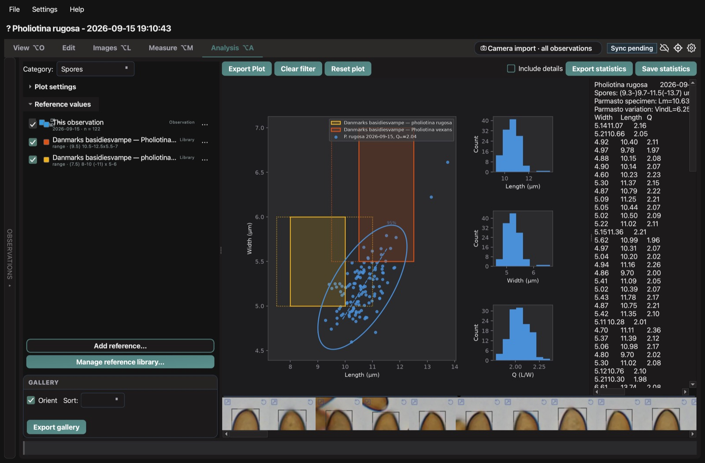

# Analysis

**Analysis** (Alt+A, Option+A on macOS) is the primary tool for visualizing and exploring spore measurements. It combines an interactive scatter/histogram plot with a thumbnail gallery, reference data overlay, and statistics export.

---

## Layout

Analysis is split into three areas:

- **Left panel:** the category filter, **Plot settings** (collapsed by default), **Reference values**, and the **Gallery** controls.
- **Centre:** the plot canvas on top and the thumbnail gallery below, with **Export Plot**, **Clear filter** and **Reset plot** above them.
- **Right:** the statistics text, with **Include details**, **Export statistics** and **Save statistics** above it.

The observation list folds into a thin rail on the left; click it to switch observations without leaving Analysis.

---

## Plot Canvas

### Scatter Plot

Plots spore Length (x-axis) vs Width (y-axis). Each point represents one measured spore. Supports zoom (scroll wheel) and pan (left-drag). Points can be clicked to filter the gallery.

### Histograms

Three stacked histograms below the scatter: Length, Width, and Q (Length/Width). Histogram bars are clickable and filter the gallery to the selected bin range. Bin count is adjustable (3–50). Histograms can be hidden via the Histogram checkbox.

---

## Plot Styles

Three mutually exclusive modes controlled by radio buttons in the Plot Settings section.

### Ellipse

Draws a confidence ellipse around the spore cloud. Coverage is configurable from 50–99% via a slider. The ellipse is labeled with its coverage percentage. Default mode.

### Kernel Density (KDE)

Draws filled contour bands representing probability density. Controls:

- **Bandwidth:** 0.5–1.5× scaling of the Gaussian kernel.
- **Contours:** 1–10 rings.
- **Coverage:** 50–99% for the outermost contour.

### Mean Range

Parmasto-style view. Shows the mean point with a cross marker, the expected mean range as a rectangle, and an average Q line. Designed for comparison against reference data using Parmasto biometrics.

---

## Plot Options

Available in the Plot Settings section (collapsed by default):

| Option | Description |
|---|---|
| Histogram | Toggle histogram visibility |
| Bins | Number of histogram bins (3–50) |
| Image color | Color scatter points by source image |
| Plot Avg Q | Overlay the mean Q line |
| Plot Q inner range | Overlay inner-percentile Q lines |
| Plot Q min/max | Overlay absolute min/max Q lines |
| Axis equal | Force square aspect ratio on scatter plot |

---

## Filtering & Selection

### Click to Filter

- **Scatter plot click:** Selects the clicked point(s) and filters the gallery to show only those spores.
- **Histogram bar click:** Filters the gallery to spores within the clicked bin's metric range (Length, Width, or Q).

The active filter is shown in a label below the gallery controls (e.g., "Length: 10.50 – 15.30").

### Multi-Select

Hold Cmd (macOS) or Ctrl (Windows/Linux) while clicking to add points or histogram bins to the current selection rather than replacing it. Related follow-up work is tracked in the [development inbox](plans/INBOX.md).

### Clear Filter

The "Clear filter" button resets all active selections and restores the full gallery.

### Category Filter

A dropdown at the top of the left panel filters measurements by category (Spores, other measurement types, or All except spores).

---

## Reference Data

The **Reference values** section (expanded by default) lists this observation and the reference datasets plotted with it. Each reference row has a checkbox to show or hide it and its colour.

### Adding reference data

1. Click **Add reference…**. A drawer opens over the plot, comparing with the observation's taxon (**Change…** picks another).
2. Choose a source: **Library** (your reference library), **Community** (shared data in Sporely Cloud) or **My observations**. In Library, search by publication, taxon or measurements; **Only this taxon** limits the list to the taxon you compare with, and range bars compare each entry's length and width with this observation's spores.
3. Tick the datasets to plot. **New reference…** adds a dataset that is not in the library yet; see [Reference data](reference-data-dialog.md).

### Row menu

The **…** menu on a reference row offers **Change color…**, **Edit measurement set…** (older single-record references; edit library datasets with **Manage reference library…**), **Update from library** when the library copy has changed, and **Remove**.

### Reference Shape Options

In **Plot settings**:

| Option | Description |
|---|---|
| Ellipse | Draw reference bounds as an ellipse |
| Square | Draw reference bounds as a rectangle |
| Min/Max | Show min/max boundary lines in addition to the main shape |

**Manage reference library…** opens the Reference Library window, where datasets and publications are edited.

---

## Gallery

Thumbnail images of each measured spore are shown below the plot. The gallery updates live as filters change.

### Gallery Controls

| Control | Description |
|---|---|
| Orient | Rotate thumbnails so the long axis is vertical |
| Sort | Order by: Images, Width, Length, or Q |
| Export gallery | Save the thumbnail grid as an image |

---

## Statistics

A plain-text stats preview shows per-measurement details for the active selection. The "Include details" checkbox adds columns for Image, Contrast, Mount, Stain, Sample, and Objective.

### Export Options

| Button | Output |
|---|---|
| Export Plot | Saves the scatter/histogram chart as SVG, PNG, or JPEG |
| Export gallery | Saves the thumbnail grid as SVG, PNG, or JPEG |
| Export statistics | Copies formatted stats to clipboard |
| Save statistics | Saves stats to a .txt file |

---

## Settings Persistence

All plot and gallery settings are saved per observation and restored automatically when you return to Analysis. This includes plot style, coverage values, reference series, sort order, the category filter, and splitter positions. Point and histogram selections and zoom are not kept.
