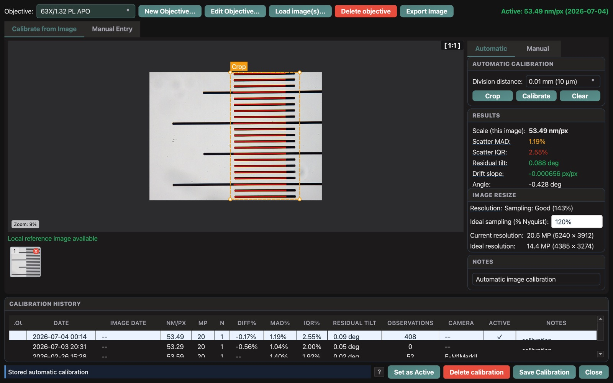

# Calibration dialog

Open it with **Settings › Calibration** (Ctrl+K, ⌘K on macOS). Use it to create, review, and activate scale calibrations for microscope objectives and macro setups.

## Main areas

- Top row: choose an objective/profile, create or edit profiles (**New Objective...**, **Edit Objective...**, **Delete objective**), load calibration images (**Load image(s)...**), and export the current view (**Export Image**). The active calibration's scale and date are shown on the right.
- **Calibrate from Image**: run automatic calibration on a slide image (**Automatic**), or measure known distances yourself (**Manual**). The **Image resize** section sets the objective's ideal sampling (% Nyquist).
- **Manual Entry**: enter a known scale directly if you already know the value.
- **Calibration History**: review saved calibrations with their scatter and tilt checks and how many observations use each, mark one as active (**Set as Active**), or delete outdated entries (**Delete calibration**).

## Typical workflow

1. Select or create the objective/profile.
2. Load one or more calibration images.
3. Run automatic calibration or add manual measurements.
4. Review the result and click **Save Calibration**.
5. Set the preferred calibration as active.

## Notes

- The active calibration is the one used for new images with that objective.
- When you save a new calibration for an objective whose images still use the previous one, **Update Measurements?** asks how far back it applies: **New calibration only** (existing images keep the previous calibration), **Update existing images** (rescale every image on the previous calibration), or **Update recent images** (only images taken today and the previous number of days you choose).
- If a calibration is already used by images or measurements, the dialog warns before deletion.

See [Microscopy workflow](microscopy-workflow.md) for calibration technique, Nyquist sampling and scale bars.
