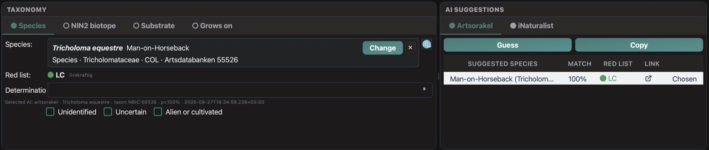

# Field Photography

## Purpose

Field photos are for documenting context, habitat, and macroscopic features. They can also be used for length/size annotations when a scale is available: either as a ruler in the focus plane, or if you shoot with a macro lens with a known magnification.

Field photos are also used for AI species recognition, using [Artsorakelet](https://orakel.artsdatabanken.no/).

## Importing Field Photos

1. In **Images › Files and SD card**, click **Choose files…** or **From SD card (new photos)**. See [Files and SD card](./prepare-images-dialog.md).
2. Mark the image **Field** (F).
3. If the photo has EXIF date and GPS, click **Use for the observation** to copy them to the observation.
4. To get more precise AI identification, draw a tight crop around the mushroom: **Crop (C)** crops the image itself, while **AI crop** only marks the area sent for recognition.

> **Note on cloud-synced images:** Images uploaded from the web app (app.sporely.no) may not carry EXIF because the cloud pipeline re-encodes uploads in the browser and strips metadata. The public cloud image tier is still described as 20 MP, but the client only downsizes when a source image exceeds `21 MP` or `5300 px` on the longest edge. The desktop restores GPS and date from the observation record automatically on sync, so **Use for the observation** should work as long as the observation has GPS or date stored. If the photo still shows no time or GPS, check that the observation has GPS and date; the backfill runs during a normal sync and skips files it has already checked.

## Field photos for AI identification

1. Open the observation in **Edit** (Ctrl+E / ⌘E from View), and select one or several (Ctrl+click) field photos in the image strip.
2. Under **AI suggestions**, choose **Artsorakel** or **iNaturalist** and press **Guess**. The table fills with suggested species and their match (Artsorakel also shows the Red List category).
3. With the **Species** tab shown under Taxonomy, select a suggestion and press **Copy** to use it as the observation's species. (With **Grows on** shown, Copy fills the host instead.)

## Measuring Lengths in Field Images

- In **Measure**, choose the **Field** category in the toolbar above the image.
- Use the **Line** tool (two clicks) to annotate length.
- Measurement overlays show **2 significant figures** with no unit label. The calibration defines the scale — if you calibrate on a 10 cm ruler, values are in cm; on a 1 m stick, in meters.
- If no scale is set, measurements are relative.

### Macro Lens Calibration

If you shoot with a macro lens, set up a profile under **Settings › Calibration › New Objective...**, selecting profile type **Macro lens**. Enter:
- Magnification as a 1:X ratio divisor (e.g. 1 for 1:1 macro, 2 for 1:2, 4 for 1:4)
- Sensor width (mm) and image width (px)

This calculates a provisional scale. For best accuracy, calibrate against a ruler in the frame instead.

## Keyboard Shortcuts

| Action | Windows / Linux | macOS |
|--------|----------------|-------|
| Edit the selected observation (from View) | Ctrl+E | ⌘E |
| View | Alt+O | Option+O |
| Images | Alt+L | Option+L |
| Measure | Alt+M | Option+M |
| Analysis | Alt+A | Option+A |

## Tips

- Use a consistent camera or include a scale reference when possible.
- Capture multiple angles of the mushroom and include the habitat.

## See also

- [Microscopy workflow](./microscopy-workflow.md)
- [Spore measurements](./spore-measurements.md)
- [Species database](./taxonomy-database.md)
- [Database structure](./database-structure.md)
