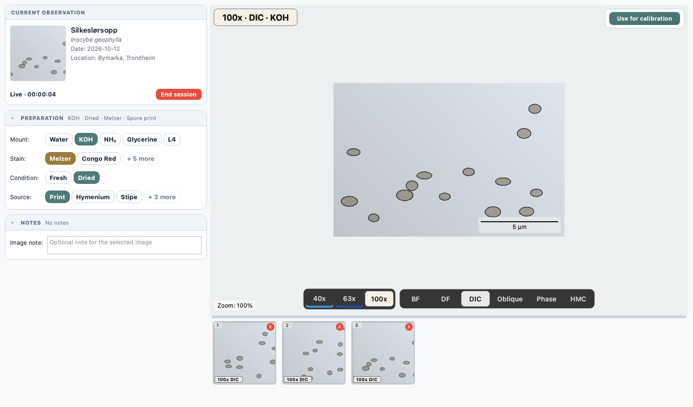

# Images › Live (microscope)

**Images › Live (microscope)** (Alt+L / Option+L opens Images with the source you used last) turns Sporely into a live microscope-ingestion workspace. It watches your microscope camera's capture folder, imports new captures into the current observation, and shows the latest one in a large viewer.

This implements the "Microscope Live Lab Mode" described in [Hardware sync and camera import](hardware-sync.md).

---

## Layout

- **Left column:** the **Current observation** card with the session controls, then **Preparation** and **Notes**, which fold to a one-line summary.
- **Right side:** the viewer, with the objective and contrast bars under the image and the current preparation above it; the shared image strip below; and the status bar at the bottom.

---

## Current observation

Live always saves captures to the observation shown in the card ("Session's observation: captures are saved here"): its name, scientific name, date and location. Choose another observation in the observation list (the rail on the left) before you start a session.

---

## Capture folder

A **Camera connected** session watches the folder that the microscope camera software saves into. Choose it with **Browse** in **Settings › Preferences › Image import** (Live Lab section), or with **Change…** next to the folder in Live. Such a session can start only when the folder exists; a **Log only** session needs no folder.

---

## Preparation

The settings attached to each new capture:

- **Objective** and **Contrast**: the bars under the image (for example 40x / 63x / 100x and BF / DF / DIC / Oblique / Phase / HMC).
- **Mount**, **Stain**, **Condition** (fresh or dried) and **Source** (for example spore print, hymenium, stipe): chips in the **Preparation** card. Settings that are not chosen are marked "not set".

They stay editable during a running session, so you can switch setup without stopping the watcher. Each new capture uses the settings active when it is imported.

## Notes

**Notes** holds an **Image note** for the selected image and timestamped session notes (**Add**), written to the session log.

---

## Session

- **Start Session** begins watching the folder. While it runs, the card shows **Live** and the elapsed time.
- **End session** stops the watcher. Unsaved RAW captures are saved when the session ends.
- **Log only** (instead of **Camera connected**) records a session without a connected camera: its preparation settings and notes are logged with their times, so [Camera import](hardware-sync.md) can match the photos later. The default session type is set in **Settings › Preferences › Image import**.

A session cannot start without an observation, and a Camera connected session also needs an existing folder.

---

## RAW Processing

Live keeps a RAW processing panel when RAW-backed captures are active. The capture mode (**Auto-save RAW** or **Review RAW**) and the RAW source (**Prefer RAW** or **Use camera JPEG**) are set in **Settings › Preferences › Image import**.

- RAW capture settings are persisted per microscope context in the local SQLite `settings` table, so Live can remember a RAW preset for each objective and contrast combination.
- In review mode, incoming RAW files wait in the strip with an orange border until you choose **Save current** or **Save to observation**, or end the session. In auto-save mode, the rendered JPEG derivative is committed immediately.
- RAW sources are decoded with `rawpy` and shown in the viewer as compressed working copies, not as live raw sensor data.
- When you change the RAW settings of a committed RAW-backed image, Sporely reopens the source RAW file and replaces the current JPEG derivative in place.
- The committed image keeps a `lab_metadata.raw_processing` snapshot with the source path, derivative path, render settings, and render timestamp.
- If the source RAW file is missing later, RAW-specific editing is unavailable for that image.

---

## Main Viewer

The large viewer behaves like the image area in Measure:

- Mouse wheel / trackpad scroll to zoom
- Drag to pan
- Zoom percentage is drawn directly on the image
- A scale bar is shown automatically when the imported image has calibrated microns-per-pixel metadata

The viewer always shows the newest imported image by default, but clicking any thumbnail in the strip swaps the main viewer to that image.
- **Use for calibration** opens the shown image in the Calibration dialog.

## Import Flow

When a new file appears in the watched folder:

1. The folder watcher waits for the file to finish writing.
2. RAW files are rendered through `rawpy` to a JPEG derivative; HEIC files are converted when needed.
3. The rendered image is inserted into the database as a microscope image for the current observation.
4. Objective, contrast, mount, stain, condition, source, and scale metadata are stored on the new image.
5. Thumbnails are generated.
6. The image is added to the image strip and loaded into the main viewer.

If the observation is also active elsewhere in the app, View and Measure are refreshed so the imported image becomes available immediately across the UI.
