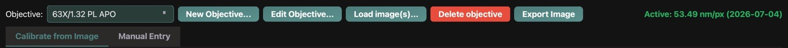
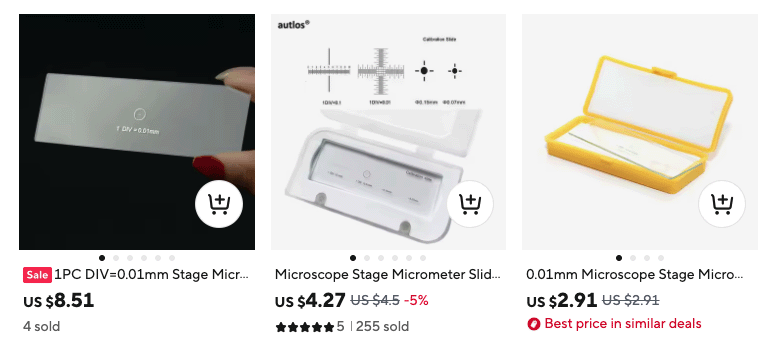
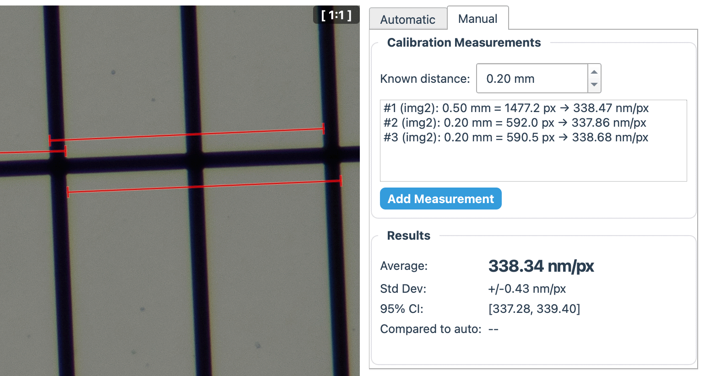
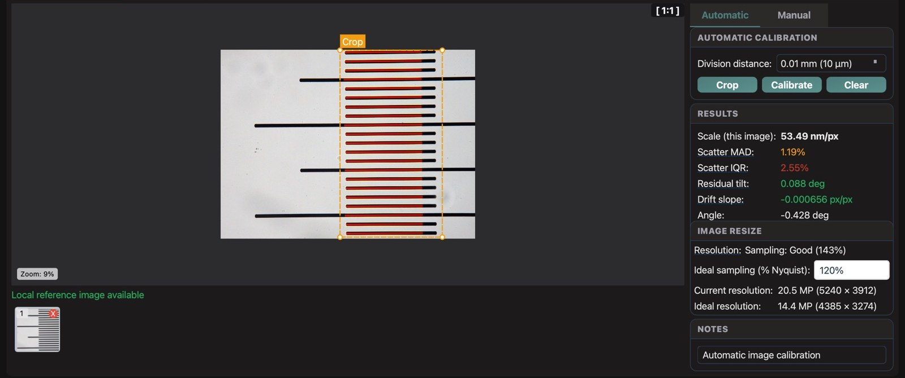
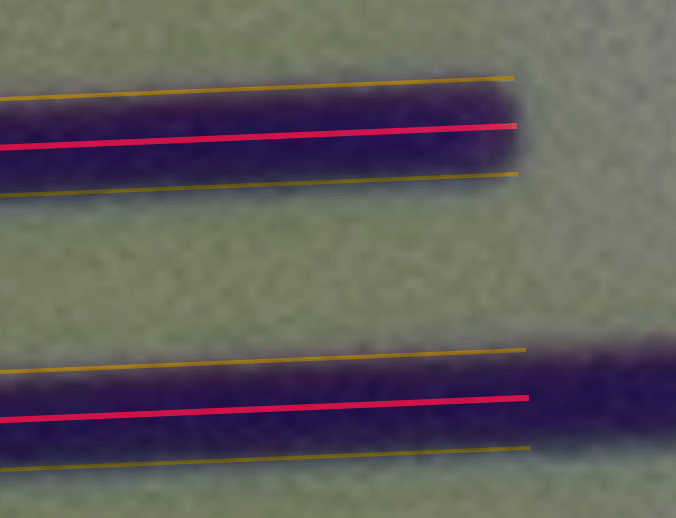

# Microscopy Workflow

## Objectives and Macro Profiles

Open **Settings › Calibration** (Ctrl+K, ⌘K on macOS) and pick an existing objective, or click **New Objective...**:

**Microscope objectives** are defined by:
- Magnification
- Numerical Aperture (NA)
- Objective name/camera setup

**Macro lens profiles** (select profile type **Macro lens** in the New Objective dialog) are defined by:
- Magnification entered as a 1:X ratio divisor (e.g. 1 for 1:1, 2 for 1:2, 4 for 1:4)
- Sensor width (mm) and image width (px) for a provisional scale

The provisional scale formula is:

$$
p = \frac{\text{sensor width (mm)} \times 1000}{\text{image width (px)}} \times \text{magnification divisor (X)}
$$

This gives an approximate µm/px scale without a physical reference. For better accuracy, calibrate against a ruler or known reference length (same as microscope calibration).

You can also add a note about your setup, what camera or lens you're using etc.

## Calibration 

Calibrating a microscope requires a calibration slide, or "stage micrometer" for accurate results. See if you can borrow one from someone, or you can buy one from Aliexpress for very little money: 

### Manual calibration
 Pick one or more known distances in your image; start and stop location. Make sure you measure from the edge of a line to the same-side edge of another line. Like this:

Check the deviation on three different measurements and check that the deviation is acceptable.

### Automatic calibration
Sporely recognizes horizontal or vertical lines. All you have to do is specify the line distance, then click ***Calibrate***.

You may have to select a cropped area if the lines are not uniform. Like here:

You will get some quality metrics, like MAD and IQR, that depend on the quality of the slide and your optics. If these numbers are way off (in red), the auto-calibration algorithm probably failed. Try cropping the image, or do manual calibration.

Zoom in to check the overlay:

The yellow lines show where the line edges have been detected. The red center lines are in the middle, between the edge lines. With poor contrast or insufficient resolution, the edge detect algorithm may fail.

## Calibration history
This is handy if you change things in your setup, and you want to document past calibrations. The history stores:
- Camera model (from exif data)
- Megapixels
- Calibration scale and statistics
- How many observations use each calibration

**Set as Active** chooses the calibration that new images use. You can export the calibration image with overlays (**Export Image**) for documentation purposes.

### Ideal sampling per objective

Each objective has an **Ideal sampling (% Nyquist)** value in the **Image resize** section of the calibration dialog. The same section shows the sampling of the current calibration image and the ideal resolution for that objective.

## Adding microscope images (Images › Files and SD card)

In **Images › Files and SD card**, mark an image as **Microscope** (keyboard shortcut: M). For microscope images, the bars on the image choose the objective (for example 40x, 63x, 100x) and the contrast method (BF, DF, DIC, Oblique, Phase, HMC). Mount, stain, condition and sample source are set in the **Slide / prep** card on the left. For an image without an objective profile, tick **Scale bar** in the **Scale** card and use **Set from scalebar** (S).

To set the same image type or scale on multiple images at once, **Ctrl+click** (or **Shift+click**) to select them in the strip, then change the setting: it applies to all selected images.

To downsample new microscope images to the objective's ideal sampling, turn on **Resize new microscope images to optimal sampling** in **Settings › Preferences › Image import**. It applies to images added in Images › Files and SD card; an image that was already resized is marked **Already resized**.

### Nyquist Sampling

Sporely uses a Nyquist-based ideal pixel size:

$$
p_{\mathrm{ideal}} = \frac{\lambda}{4\,\mathrm{NA}}
$$

where $\lambda$ is the illumination wavelength in $\mathrm{\mu m}$ and $\mathrm{NA}$ is the numerical aperture. If you have a high-resolution sensor with a 100/1.25 objective, you could potentially reduce the image file size by quite a lot. As your database grows, and if you want to share your database with others, this file size reduction can be quite important.

### Downsampling and Scale Propagation

If an image is resampled by a uniform factor $f$, the scale
and megapixels adjust as follows:

$$
p_{\mathrm{target}} = \frac{p_{\mathrm{full}}}{f}, \qquad
M_{\mathrm{target}} = M_{\mathrm{full}} \cdot f^{2}
$$

where $f$ is the linear resampling factor ($0 < f \le 1$), $p_{\mathrm{full}}$ is the
original scale in $\mathrm{\mu m}/\mathrm{px}$, $p_{\mathrm{target}}$ is the resampled scale in $\mathrm{\mu m}/\mathrm{px}$,
$M_{\mathrm{full}}$ is the original megapixels, and $M_{\mathrm{target}}$ is the resampled megapixels.

Sporely uses this relationship instead of requiring a second calibration on the
downsampled image.

## Resolution Mismatch Warning

The mismatch warning is still active, but only shown when all of these are true:
- Image type is microscope
- A normal objective is selected (not **Not set** or **Scale bar**)
- A calibration with usable resolution info exists
- The image/calibration resolution difference is large enough to matter

Sporely compares calibration megapixels with the image megapixels and accounts for resize factor when relevant.  
A mismatch can be expected for heavily cropped images.

You may see this warning in both:
- **Measure**, in the **Scale** section above the image (its summary line turns red)
- **Images › Files and SD card**, in the **Scale** card

## Images › Files and SD card shortcuts

- **F**: Set image type to Field
- **M**: Set image type to Microscope
- **C**: Crop
- **S**: Set from scalebar
- **N** / **P** or **→** / **←**: Next / previous image
- **Delete** (or Ctrl+D / ⌘D): Remove selected image(s)

## Mode shortcuts

Switch modes from View, Images, Measure, Analysis or Camera import (not from Edit; use the mode bar there). **Images** opens the source you used last, Live or Files and SD card.

| Action | Windows / Linux | macOS |
|--------|----------------|-------|
| View | Alt+O | Option+O |
| Edit the selected observation (from View) | Ctrl+E | ⌘E |
| Images | Alt+L | Option+L |
| Measure | Alt+M | Option+M |
| Analysis | Alt+A | Option+A |
| Camera import | Alt+C | Option+C |

## Appearance

The app follows the system dark/light mode automatically when **Settings › Preferences › Appearance** is set to **Auto (follow system)**. Changes take effect immediately without restarting.

## Working with scale in Measure

- Open the **Scale** section above the image and choose the objective in the dropdown. Its summary line names the objective and calibration while the section is closed.
- For microscope images, make sure the correct objective is applied before measuring.

## Scale bar calibration (manual)

If you need a custom scale (field images or slides without an objective profile):

1. In Measure, open the **Scale** section and click **Set from scalebar**.
2. Enter the real-world length of the scale bar: in µm for a microscope image, in mm for a field image. Tick **Horizontal** to keep the line level.
3. Click the two ends of the scale bar in the image.

The image's scale is then **From scalebar**. If you start measuring an image without a scale, the status line asks you to set one with **Set from scalebar** first.

## See also

- [Database Settings](./database-settings.md)
- [Field photography](./field-photography.md)
- [Spore measurements](./spore-measurements.md)
- [Species database](./taxonomy-database.md)
- [Database structure](./database-structure.md)
