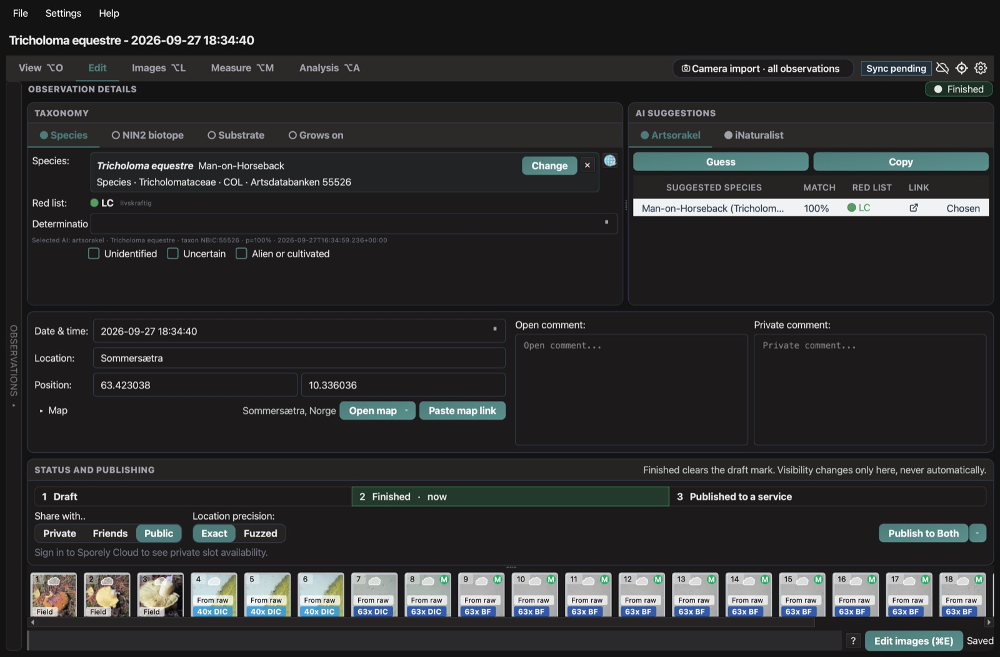

# Edit

**Edit** opens the selected observation in the main window (click **Edit** in the mode bar, or press Ctrl+E / ⌘E in View). Changes save as you go; the bottom bar shows **Saved** when they are stored. A new observation starts in **Images › Files and SD card** (see [Files and SD card](prepare-images-dialog.md)) and opens in Edit once it is saved.

## Main areas

- **Taxonomy**: one search field for the species (scientific or common name) and the identification card, with **Change** to pick another name. Tabs for host (**Grows on**), and for habitat and substrate where the region's reporting service uses them (**NIN2 biotope** and **Substrate** in Norway). **Unidentified**, **Uncertain** and **Alien or cultivated** mark the identification. The Red List category is shown under the card.
- **AI suggestions**: **Artsorakel** and **iNaturalist** tabs. **Guess** sends the observation's photos to the service; **Copy** copies the selected suggestion to the taxonomy.
- **Date & time**, **Location**, **Position** (latitude, longitude) and **Map** (**Open map**, **Paste map link**), plus **Open comment** and **Private comment**.
- **Status and publishing**: whether the observation is a **Draft**, **Finished** or **Published to a service**; who can see it in Sporely Cloud (**Private**, **Friends**, **Public**) and how precisely its location is shown (**Exact**, **Fuzzed**); and the publish button for your reporting services. See [Online publishing](artsobservasjoner.md).
- The image strip at the bottom shows the observation's images. **Edit images** (Ctrl+E / ⌘E) opens them in **Images › Files and SD card**.

## Typical workflow

1. Check date, place, and coordinates.
2. Search for the taxon and pick a row, or **Guess** and copy an AI suggestion to the taxonomy.
3. Add comments, habitat, substrate and host.
4. Mark it **Finished** and choose who can see it.
5. Publish it to a reporting service, if you use one.

## Notes

- A name that is not linked to a taxon shows a "Name without a taxon: not linked to the taxonomy" card. When the observation's AI identifier and the entered name point to one taxon, a **Link** offer appears under the card; nothing is linked until you press it or pick a row.
- Some Artsorakel identifiers are attached to their taxon only by an automatic name match in the taxonomy release, so **Copy** leaves them unlinked. Link is still offered for them when the names agree, and binds the taxon as if you had picked it in the search.
- Visibility changes only when you change it here; marking an observation Finished does not make it public.
