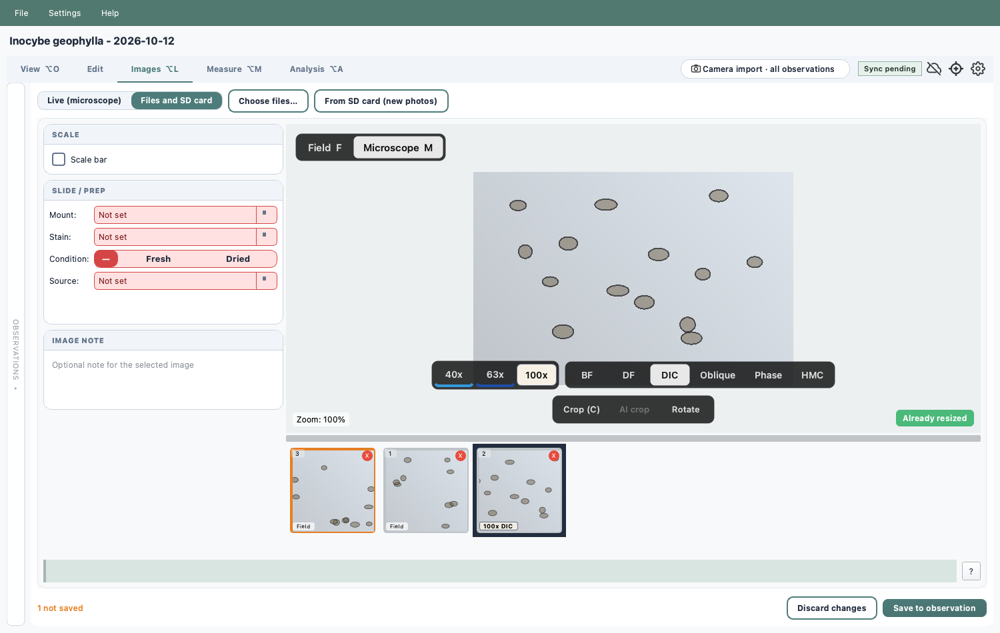

# Images › Files and SD card

**Images › Files and SD card** adds field and microscope photos to the current observation, and reviews and tags its images. It is also where a new observation starts: **New** (N) in View opens it for an observation that is not saved yet.

## Main areas

- **Top row**: the source switch (**Live (microscope)** / **Files and SD card**), **Choose files…**, and **From SD card (new photos)**, which adds the photos on the camera's card that are not in Sporely yet and were taken on the observation's day.
- **Left column**: for microscope images, the **Scale** card (**Scale bar** for an image without an objective profile) and the **Slide / prep** card (mount, stain, condition, source); for every image, the **Image note**; for RAW files, **RAW processing**.
- **On the image**: **Field** / **Microscope** at the top left. For a field photo, its date, time and GPS with **Use for the observation**. For a microscope image, the objective and contrast bars. **Crop (C)**, **AI crop** (field photos) and **Rotate** at the bottom, and **Info** at the top right for the photo's EXIF.
- **Image strip**: the observation's images, new ones first. Click to select, Ctrl/Shift+click to select several, drag to reorder.
- **Bottom row**: **Discard changes** and **Save to observation** (**Save new observation** for a new one). Unsaved images are marked in the strip and the observation list, and stay with their observation until you save or discard them.

## Typical workflow

1. Click **Choose files…** or **From SD card (new photos)**, or drag files in.
2. Mark each image **Field** or **Microscope** (`F` / `M`).
3. For **field images**: if the photo has EXIF date and GPS, click **Use for the observation** to copy them to the observation.
4. For **microscope images**: choose the objective and contrast on the image, and mount, stain, condition and source in **Slide / prep**. Use **Scale bar** and **Set from scalebar** for images without an objective profile.
5. Crop or rotate images where needed.
6. Click **Save to observation**. A new observation is saved as a draft and opens in [Edit](observation-dialog.md).

## RAW Processing

When a selected file is a camera RAW, a **RAW processing** card appears in the left column.

- RAW previews and the final conversion use `rawpy`; the working copy written here is a JPEG derivative in the local `imports/` folder.
- The render snapshot is stored with the image record as `lab_metadata.raw_processing`, including source path, derivative path, dimensions, and the current RAW settings.
- The original source location is kept in `original_filepath` when original-storage is enabled, and the raw source path is also stored in `lab_metadata.raw_processing.source.path`.
- If the RAW source file is still available later, RAW-backed images can be re-rendered from the RAW file instead of editing the JPEG derivative in isolation.
- HEIC/HEIF files are handled separately and become JPEG working copies without `raw_processing`.
- If microscope auto-resize runs later in the import pipeline, the working copy may be replaced with a WebP downsample. RAW conversion itself does not use WebP.

## "Use for the observation"

Copies the selected field photo's EXIF GPS and `DateTimeOriginal` into the observation's date/time and position. It shows for a single field photo with GPS or date in its EXIF, and reads **Used for the observation** when the photo is already the observation's time and GPS source.

### Cloud-synced images and EXIF

Images synced from the web app (app.sporely.no) may have no EXIF because the cloud pipeline re-encodes uploads in the browser, which strips all EXIF. The public cloud image tier is still described as 20 MP, but the client only downsizes when a source image exceeds `21 MP` or `5300 px` on the longest edge. The desktop app mitigates missing EXIF by writing the observation's stored GPS and date back into the JPEG EXIF when downloading cloud images. This means **Use for the observation** works for cloud images as long as the observation itself has GPS/date recorded.

If a cloud-synced field image still shows no time or GPS, trigger a cloud sync — the backfill runs automatically on each sync pass.

## Notes

- Microscope images can be downsampled to the objective's ideal sampling when **Resize new microscope images to optimal sampling** is on in **Settings › Preferences › Image import**.
- Scale-bar calibration here is meant for imported images that already contain a visible scale bar.
- Images imported on desktop keep a local working copy. RAW and HEIC sources are decoded to JPEG, and microscope auto-resize can later switch the working copy to WebP. The cloud copy may be resized under the public 20 MP tier's internal `>21 MP` / `>5300 px` gate.

## Keyboard shortcuts

| Action | Key |
|---|---|
| Set image type: Field | `F` |
| Set image type: Microscope | `M` |
| Crop | `C` |
| Set from scalebar | `S` |
| Next image | `N` or `→` |
| Previous image | `P` or `←` |
| Remove selected | `Del`, `Ctrl+D` / `⌘D` or `Alt+D` |
