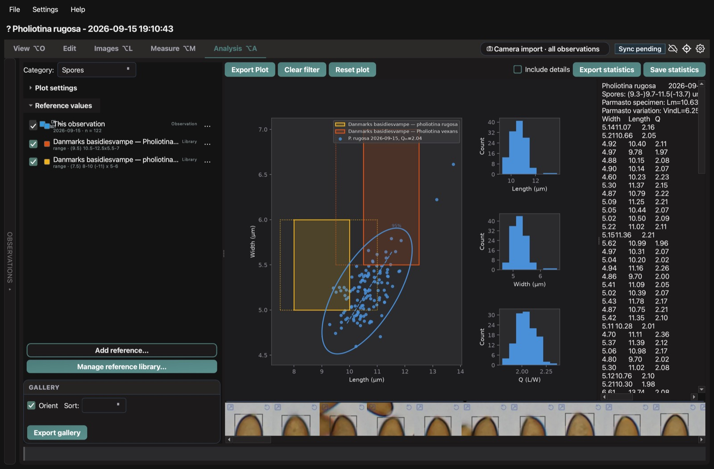

# Reference data

Reference data is spore data from the literature, from other Sporely users,
or from your own observations, plotted next to an observation's measurements
in **Analysis**. Library data is stored in the normalized reference library
(`reference_works`, `reference_taxon_treatments`,
`reference_measurement_sets`), and Library references attached to an
observation are recorded in `observation_reference_uses`. Community and
My observations data is added to the plot as series.

## Adding a reference to the plot

**Add reference…** under **Reference values** in Analysis opens a drawer
over the plot. It compares with the observation's taxon (**Change…** picks
another) and has three sources:

- **Library**: your reference library. Search by publication, taxon or
  measurements; **Only this taxon** limits the list to the taxon you
  compare with. Range bars compare each entry with this observation. Badges show how each entry relates to it (for example *Same taxon*)
  and what it holds (*Raw data*, *Published range*).
- **Community**: reference data shared in Sporely Cloud.
- **My observations**: your own measured observations of the taxon.

Tick an entry to plot it. An expanded, attached Library entry shows its
citation, values and a **Role** (**Compared**, **Supports identification**
or **Contradicts**).

## New reference dialog

**New reference…** at the bottom of the drawer opens **New reference**, in
two steps:

1. **Source**: the publication, the name as published and the locator (page,
   figure). Choose an existing publication from the library or create one.
2. **Measurements**: paste the measurement string from the literature, for
   example `(8.1–)8.5–10.8(–11.4) × (4.2–)4.5–5.8(–6.1) µm`, and press
   **Parse**, or choose **Fill in manually**. Individual spore rows and
   **Parmasto Biometrics** are behind their own disclosures.

**Save to library** stores the reference; **Add to plot** also plots it with
the current observation. The dialog closes only when the save succeeded.

## Editing a plotted reference

The **…** menu on a row under **Reference values** offers **Change color…**,
**Edit measurement set…** for older single-record references (library
datasets are edited in the Reference Library), **Update from library** when the
library copy has changed since it was plotted, and **Remove**.

## Reference Library manager

The Reference Library manager (`ReferenceLibraryManagerDialog`, window
title **Reference Library**) is a standalone top-level dialog opened from
**Manage reference library…** in Analysis.

It presents three panes:

1. **Publications** — a searchable table of `reference_works`.
   Substring search matches title, short label, container title, and
   authors. The third column shows a derived, non-blocking count of
   missing bibliographic fields (from
   `reference_work_completeness_hints`). Verification and per-work
   visibility have been removed from the product; see the reference-
   library plan for the current public-exposure model.
2. **Treatments and measurement sets** — a hierarchical tree of
   `reference_taxon_treatments` under the selected work, with each
   treatment's `reference_measurement_sets` shown as children.
3. **Details** — the selected record's fields plus context actions
   (edit, new treatment, new measurement set, and attach to the active
   observation when one is open). Measurement-set details are composed
   through `build_observation_reference_snapshot`, so no UI-side
   fabrication of missing values occurs.

Create/edit forms delegate to the existing repositories:

- `ReferenceWorkRepository.create` / `update` — UUID assigned on create,
  revision preserved and bumped on update.
- `TaxonTreatmentRepository.create` / `update` — inherits
  `reference_work_id`; separate UUID + revision.
- `MeasurementSetRepository.create` / `update` — offers only the
  plot-supported kinds (`range`, `summary`, `raw_points`) for new
  records. Existing `parmasto` records remain visible and editable but
  cannot be created from the UI.

Rules:

- Empty numeric inputs map to SQL `NULL`. The manager never fabricates
  zero, midpoint, or synthesised bound values.
- Editing an existing `raw_points` record preserves any aggregate
  statistics already stored on the row; only an explicit kind
  conversion clears them.
- The detail panel shows a translated "not plottable yet" hint when the
  selected measurement set has no drawable geometry (mirroring the
  translator's finite-positive rule so the desktop plot layer would
  reject it).
