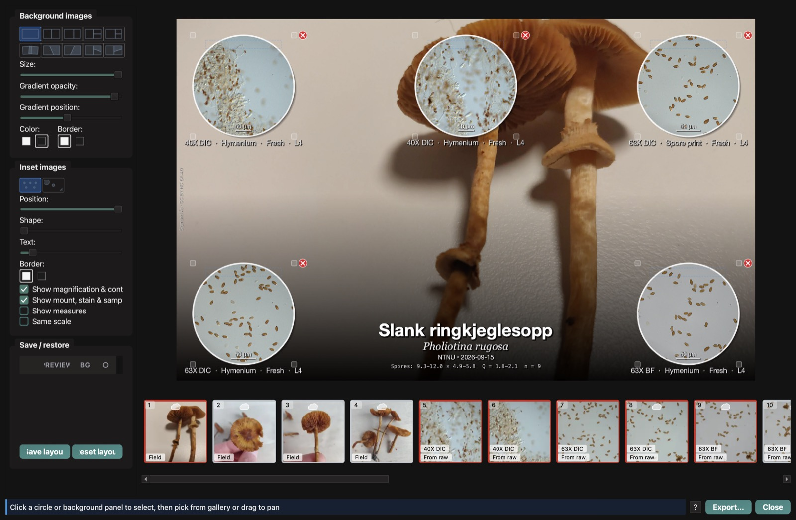

# Species plate dialog

Select one observation in **View** and click **Plate** to open this dialog. Use it to build a presentation plate from that observation, combining field photos, microscope images, labels, and measurements.

## Main areas

- Background images: choose the background layout, size, gradient, and border style.
- Inset images: choose circle layout, size, position, shape, border, and text settings.
- Save / restore: save a reusable `.mplate` layout, reload a saved layout, or reset to defaults.
- Preview and gallery: assign images to panels/circles and adjust crops interactively.

## Typical workflow

1. Choose a background layout.
2. Assign field and microscope images from the gallery.
3. Adjust crops and inset positions.
4. Decide whether to show technical badges and measurements.
5. Export the finished plate.

## Notes

- Saved layouts store presentation settings so they can be reused later.
- **Same scale** makes microscope inset circles share the same physical scale when possible.
- **Export…** creates the final plate file; closing the dialog does not export automatically.
- Saved layouts are `.mplate` files in a `plate_layouts` folder next to the database. The current plate is also remembered for each observation.
